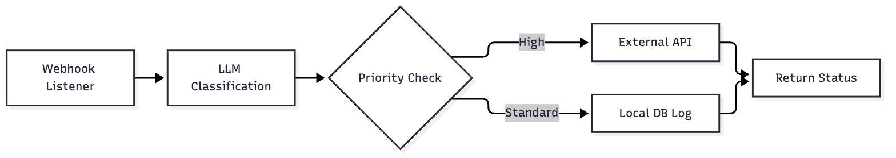
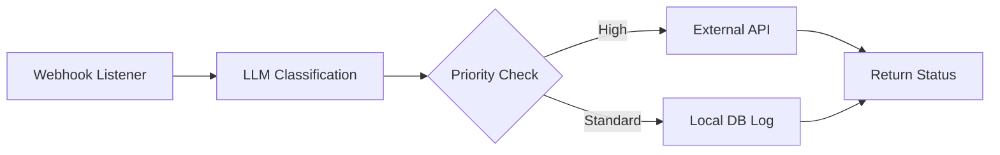

# Flowforge MVP

A small, working Python MVP inspired by n8n AI.

## Core Job
Orchestrate self-hosted, complex AI-driven automations with full data sovereignty.

## Workflow
1. Receive webhook trigger.
2. Pass payload to LLM node for classification.
3. If classification is 'high_priority', send to external API; else, log to local DB.
4. Return execution status.

## Components
- Workflow engine (backend)
- LLM integration module (simulated)
- Webhook listener
- Conditional logic node
- Execution logger

## Installation
```bash
pip install -r requirements.txt
```

## Running
```bash
uvicorn main:app --reload
```

## Demo
```bash
python -c "from main import demo; demo()"
```

## Tests
```bash
pytest -q
```

## Architecture



<details>
<summary>Mermaid source</summary>



</details>
